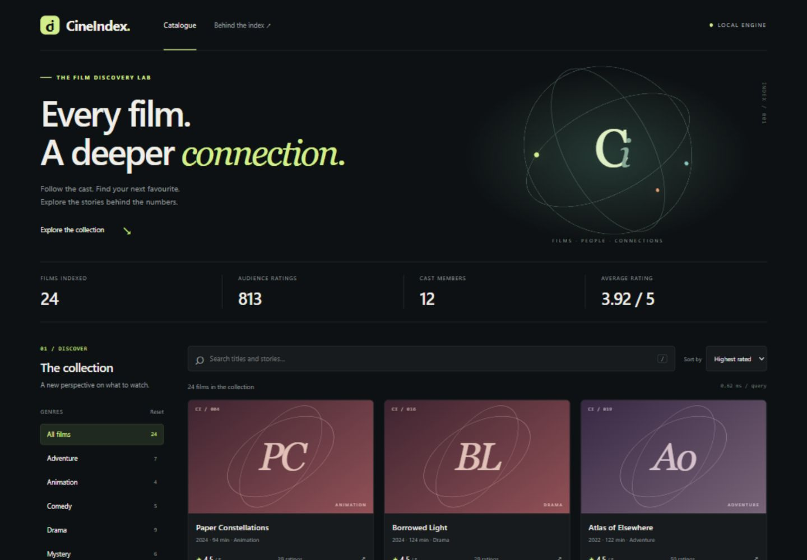
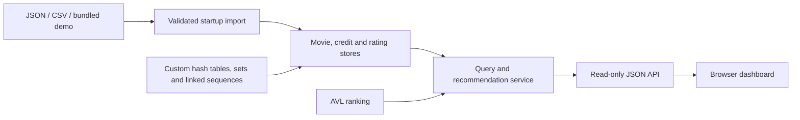

<div align="center">

# CineIndex

### A movie discovery and analytics engine, built from the data structures up.

[](https://github.com/joshbeira/cineindex/actions/workflows/ci.yml)


[Quick start](#quick-start) · [Architecture](docs/architecture.md) · [API reference](docs/api.md) · [Benchmarks](docs/benchmarks.md)

</div>



CineIndex turns film metadata, cast relationships and audience ratings into an interactive catalogue. Search the collection, inspect a rating distribution, follow an actor's filmography, or discover a related film with an explanation of what connects it.

Under the interface is a Java indexing engine with custom hash tables, hash sets, doubly linked sequences and AVL trees. The project makes the engineering visible: query timing in the dashboard, explicit complexity analysis, regression tests, and a reproducible workload covering up to **50,000 films and 500,000 ratings**.

## What it does

- **Discover:** case-insensitive search across titles and overviews, genre and minimum-rating-count filters, three ranking modes, and stable pagination.
- **Explore:** movie details, cast filmographies, crew credits, and audience rating histograms.
- **Connect:** explainable recommendations scored by shared genres and cast. Every result includes its matching reasons.
- **Import:** start with the bundled fictional demo, load a JSON catalogue, or import compatible movie, credit and rating CSV files.
- **Integrate:** use the same catalogue through a small, documented read-only JSON API.

## Quick start

Install **JDK 17 or 21** and set `JAVA_HOME` to the JDK directory. The Gradle wrapper downloads the build tooling and dependencies on the first run.

```bash
git clone https://github.com/joshbeira/cineindex.git
cd cineindex
./gradlew run
```

On Windows PowerShell:

```powershell
git clone https://github.com/joshbeira/cineindex.git
cd cineindex
.\gradlew.bat run
```

Open **[localhost:8080](http://127.0.0.1:8080)**. The demo includes **24 fictional films, 813 synthetic ratings, 12 cast members and 4 directors**. No API keys, database or frontend build step is needed. Press `Ctrl+C` in the terminal to stop the application.

Prefer a packaged application? Download and extract the ZIP from [Releases](https://github.com/joshbeira/cineindex/releases), then run `bin/cineindex` or `bin\cineindex.bat`. A JDK is still required; Gradle is not.

### Bring your own catalogue

```bash
./gradlew run --args="--catalog /path/to/catalog.json"
./gradlew run --args="--csv-dir /path/to/csv-directory"
./gradlew run --args="--port 9090"
./gradlew run --args="--inspect"
```

On Windows, replace `./gradlew` with `.\gradlew.bat`. Use `--help` for all options. See [data formats and a minimal example](docs/data.md) for import details. Local `data/` and `local/` directories are ignored by Git.

## Engineering highlights

| Component | Implementation | Why it matters |
| --- | --- | --- |
| Identity indexes | Chained hash tables with resizing at a 0.75 load factor | Expected constant-time entity lookup |
| Relationship indexes | Film-to-credit arrays and person-to-film hash sets | Direct filmography queries without a full catalogue scan |
| Ratings | Two indexes sharing immutable records, with cached sums | Expected constant-time add, update, removal and average lookup |
| Ranking | AVL tree with duplicate-key support and bounded traversal | Balanced ordering and top-result extraction |
| Bulk traversal | Iterable doubly linked sequences | Avoids repeated indexed walks through linked lists |
| Serving | JDK HTTP server over a catalogue loaded before startup | Concurrent read-only queries with no database service |

The domain indexes use the custom collections. Standard Java utilities handle transport, parsing, benchmarking and reference tests. Ranked searches build temporary trees per request; text search scans the catalogue. [Architecture and trade-offs →](docs/architecture.md)



## Verify and measure

```bash
./gradlew test          # Unit, invariant, import and HTTP integration tests
./gradlew benchmark     # Seeded workload with warm-up and median timings
./gradlew build         # Tests plus ZIP/TAR distributions
```

Tests exercise hash collisions and resizing, randomized operations against JDK reference models, duplicate-key ordering, rating aggregate consistency, import errors, API validation, concurrent reads and stable pagination. CI runs the suite on **Windows and Linux, with Java 17 and 21**.

Reports are generated at `build/reports/tests/test/index.html` and `build/reports/jacoco/test/html/index.html`. CI also publishes the reports and application archives as downloadable artifacts.

In a local reference run, the 50,000-film / 500,000-rating fixture loaded in a median **102.8 ms**, and the store-level top-20 query completed in **7.4 ms**. These are synthetic, machine-specific workload measurements, not HTTP latency or production guarantees. [Full methodology, results and limitations →](docs/benchmarks.md)

## Repository map

```text
src/main/java/dev/cineindex/
  app/          CLI, local HTTP server and benchmark runner
  io/           JSON and CSV import boundary
  service/      Search, ranking, statistics and recommendations
  store/        Movie, credit and rating indexes; immutable domain values
  structure/    Custom hash table, hash set, linked sequence and AVL tree
src/main/resources/
  demo/         Original fictional catalogue and synthetic ratings
  web/          Browser interface, CSS and JavaScript
src/test/java/  Regression and integration tests
docs/          Architecture, API, data formats, benchmarks and screenshots
.github/       CI, dependency updates and contribution templates
```

## Scope

CineIndex is a local, in-memory discovery application. It binds to `127.0.0.1`, loads one catalogue at startup and exposes read-only HTTP endpoints. It has no accounts, write API, persistent database or public-hosting configuration. The recommendations use a documented overlap heuristic; they are not a trained recommendation model. These boundaries keep the indexing behaviour inspectable and the demo easy to reproduce.

## Contributing and licence

See [CONTRIBUTING.md](CONTRIBUTING.md) for development guidance and [CHANGELOG.md](CHANGELOG.md) for release history. Code and original demo content are available under the [MIT licence](LICENSE). Third-party components and imported datasets retain their own terms; see [NOTICE.md](NOTICE.md).
